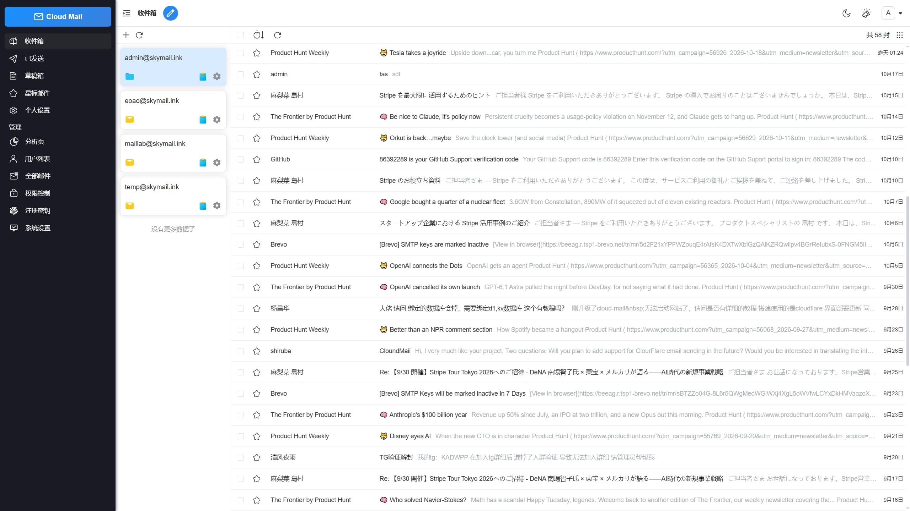
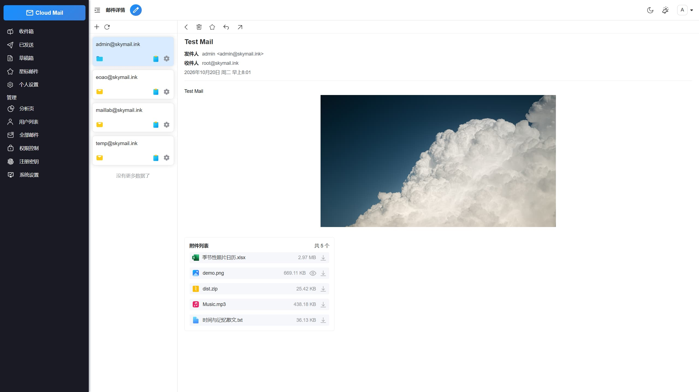
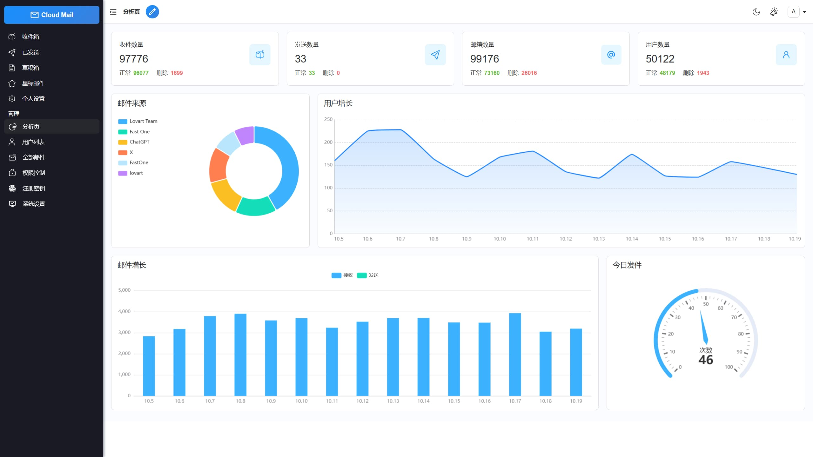
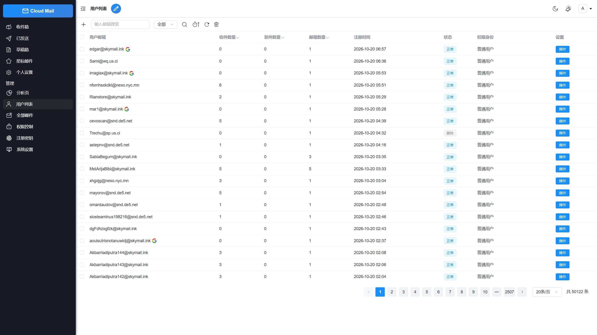

<p align="center">
    
    <h1 align="center">Cloud Mail Plus</h1>
    <p align="center"><strong>基于 Cloudflare 的一站式邮件服务平台（二次开发版）</strong></p>
    <p align="center">
        <a href="https://www.cloudflare.com/" target="_blank">
            
        </a>
        
    </p>
</p>

> **出处说明**：本仓库基于开源项目 **[maillab/cloud-mail](https://github.com/maillab/cloud-mail)** 二次开发，遵循上游的 MIT 许可证（见 [LICENSE](LICENSE)，版权归原作者所有）。原项目地址：https://github.com/maillab/cloud-mail ，部署文档可参考上游 [文档站](https://docs.skymail.ink)。

## 本版改动（相对上游）

### 1. 新增 Brevo 发信通道

上游发信仅支持 Cloudflare Email Service 与 Resend，而 **Resend 明确拒绝免费公共域名**（如各大免费域名服务商的域名），这类域名无法在 Resend 完成认证、发不了信。本版在 `mail-worker` 的发信服务中新增了 [Brevo](https://www.brevo.com/)（原 Sendinblue）通道：

- Brevo 免费额度 **300 封/天**、不绑卡，免费域名可完成域名认证（DKIM/DMARC 记录齐全）
- 发信通道优先级：**站内直投 > Cloudflare Email 绑定 > Brevo > Resend**（配置了 Brevo 密钥才启用 Brevo，未配置时行为与上游一致）
- API Key 通过 Worker Secret 注入，不要写进代码或配置文件：

```bash
cd mail-worker
npx wrangler secret put BREVO_API_KEY
```

### 2. 真抄送（CC）功能

上游发信没有抄送：收件人参数只有 `receiveEmail`，想抄送只能把人塞进收件人栏。本版补齐了完整的抄送支持：

- 后端 `send()` 支持 `ccEmail` 参数（自动去重，并与收件人去重）
- 四条发信通道全部接通抄送：站内直投、Cloudflare Email、Brevo、Resend
- 发信记录落库保存抄送人；发送计数包含抄送人数
- 前端写信页有独立「抄送」输入栏；邮件详情页显示抄送行
- 回复邮件时自动带回原邮件的抄送人（排除自己）
- 中英文 i18n 均已补 `cc` 文案

## 项目简介

只需要一个域名，就可以创建多个不同的邮箱，类似各大邮箱平台。本项目支持部署到 Cloudflare Workers，降低服务器成本，搭建自己的邮箱服务。

## 项目展示

|   |  |
|--------------------------|--------------------------|
|  |  |

## 功能介绍

- **💰 低成本使用**：可部署到 Cloudflare Workers 降低服务器成本
- **💻 响应式设计**：响应式布局自动适配 PC 和大部分手机端浏览器
- **📧 邮件发送**：集成 Cloudflare Email Service、**Brevo（本版新增）** 和 Resend，支持群发、**抄送（本版新增）**、内嵌图片、附件发送和发送状态查看
- **🛡️ 管理员功能**：可以对用户、邮件进行管理，RBAC 权限控制对功能及使用资源限制
- **📦 附件收发**：支持收发附件，使用 R2 对象存储保存和下载文件
- **🔔 邮件推送**：接收邮件后可以转发到 TG 机器人或其他服务商邮箱
- **📡 开放 API**：支持使用 API 批量生成用户，多条件查询邮件
- **🔢 验证码识别**：使用 Workers AI，自动识别邮件验证码
- **📈 数据可视化**：使用 ECharts 对系统数据详情、用户邮件增长可视化显示
- **🎨 个性化设置**：可以自定义网站标题、登录背景、透明度
- **🤖 人机验证**：集成 Turnstile 人机验证，防止人机批量注册

## 技术栈

- **平台**：[Cloudflare Workers](https://developers.cloudflare.com/workers/)
- **Web 框架**：[Hono](https://hono.dev/)
- **ORM**：[Drizzle](https://orm.drizzle.team/)
- **前端框架**：[Vue3](https://vuejs.org/)
- **UI 框架**：[Element Plus](https://element-plus.org/)
- **发信服务**：[Cloudflare Email Service](https://developers.cloudflare.com/email-service/) / [Brevo](https://www.brevo.com/) / [Resend](https://resend.com/)
- **缓存**：[Cloudflare KV](https://developers.cloudflare.com/kv/)
- **数据库**：[Cloudflare D1](https://developers.cloudflare.com/d1/)
- **文件存储**：[Cloudflare R2](https://developers.cloudflare.com/r2/)

## 部署要点

完整部署流程（建 D1/KV/R2、开 Email Routing、绑自定义域）请看上游文档：https://docs.skymail.ink 。本版只需额外注意：

1. 需要自备一个 **Cloudflare 账号**，并按 `mail-worker/wrangler.toml` 里的占位提示填入你自己的 D1 数据库 ID、KV 命名空间 ID、邮件域名和管理员邮箱（仓库里的是示例占位值）。
2. 想用 Brevo 发信：先在 Brevo 注册并完成你域名的认证，再把 API Key 用 `wrangler secret put BREVO_API_KEY` 写入 Worker Secret（见上文）。不用 Brevo 的话可跳过，Resend 通道照常可用（在系统设置里填 Resend 令牌）。
3. `jwt_secret` 请务必改成你自己生成的随机字符串。

## 目录结构

```
cloud-mail
├── mail-worker                    # worker后端项目
│   ├── src
│   │   ├── api                    # api接口层
│   │   ├── service                # 业务服务层（发信通道在 email-service.js）
│   │   └── index.js               # 入口文件
│   ├── package.json               # 项目依赖
│   └── wrangler.toml              # 项目配置（占位示例，部署时改成自己的）
│
├── mail-vue                       # vue前端项目
│   ├── src
│   │   ├── layout                 # 主体布局组件（写信页含抄送栏）
│   │   ├── views                  # 页面组件
│   │   └── main.js                # 入口js
│   └── package.json               # 项目依赖
```

## 许可证

本项目采用 [MIT](LICENSE) 许可证（与上游一致，版权归原作者所有）。
